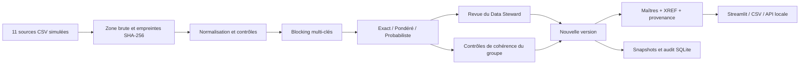

# Architecture du hub hospitalier

La version **Hôpital Al Amal** ajoute un parcours commun de six onglets et trois scénarios pour chacun des domaines. Voir [le guide hospitalier](hopital_al_amal.md). Les huit tables liées conservent leur contenu brut, leur empreinte et leur rattachement à un maître ; leur contenu n’est pas utilisé dans les caractéristiques de matching.

Les arbitrages d’attributs et les décisions cliniques disposent de tables d’événements transactionnelles distinctes, intégrées à la vérification du journal. Un arbitrage ne peut retenir qu’un candidat observé. Une validation d’allergie porte sur une déclaration et son empreinte ; une modification de cette déclaration invalide sa réapplication. Les fonctions cliniques restent déclaratives dans la démonstration sans authentification.

La préparation de réconciliation utilise `persist=False` : elle calcule une proposition sans créer de snapshot ou d’événement de publication. Le bouton de publication recalcule les contrôles, crée une nouvelle version et conserve les anciennes.

Le dépôt initial est conservé : notebook patient, CSV historiques, moteur `reconciliation.py`, tests associés et interface déplacée vers `legacy_app.py`. Le nouveau moteur `mdm/` reconstruit lui-même les rapprochements des trois domaines.

La vérité synthétique est conservée hors du moteur. `evaluation.py` lit les étiquettes après les décisions pour mesurer les résultats. Aucun `entity_id` de vérité ne figure dans les caractéristiques de matching.

## Décisions de conception

| Décision | Motif et limite |
| --- | --- |
| Trois domaines, un moteur configurable | Mutualiser ingestion, contrôles, journal et publication des versions |
| SQLite transactionnel pour la démo | Démarrage local sans serveur ; PostgreSQL préparé séparément |
| Sources brutes conservées dans chaque snapshot | Retrouver la saisie initiale et ses erreurs |
| Blocking par union de clés | Réduire les comparaisons ; perte possible de vraies paires mesurée par le rappel global |
| Identifiant qualifié par un émetteur | Un matricule local seul ne permet pas de relier deux applications |
| Numéros de démonstration explicitement synthétiques | Ne pas assimiler un code de démo à un identifiant sanitaire officiel |
| Revue explicite et justifiée | Aucune simulation automatique de réviseur parfait |
| Contrôles sur toutes les paires du groupe fusionné | Bloquer les contradictions transitives et respecter les rejets humains |
| Champs cliniques exclus du matching | Les allergies sont des relations sourcées, jamais une preuve d’identité |
| Priorité par source pour la survivorship | Règle déterministe, indépendante d’une récence dont le sens peut varier |
| UUID dérivé de l’appartenance au groupe | Stable si membres inchangés ; nouvel UUID après fusion/défusion, avec lignage |
| Versions immuables | Revenir à une ancienne version sans écraser les résultats ; pas de propagation vers les sources |

Le champ `updated_at` d’une source est conservé sans intervenir dans le score ni dans la priorité. Les erreurs sont signalées au niveau attribut. Une date invalide devient vide ; les autres attributs valides de la ligne restent exploitables, sous les exigences minimales de preuve.

Le prototype n’est pas multi-utilisateur authentifié : le nom du réviseur est déclaratif. SQLite sérialise les écritures et protège la cohérence décision/audit, sans fournir de contrôle d’accès institutionnel. Une chaîne SHA-256 détecte une modification partielle des événements et des snapshots. Un administrateur local peut réécrire toute la chaîne : une signature et un stockage externes seraient nécessaires pour prouver l’intégrité face à cet acteur.

## Différence entre référentiel et transactions

Le personnel maître identifie une personne ; son affectation reste une relation temporelle. Le patient maître porte l’identité ; les allergies restent des déclarations cliniques sourcées. Le produit maître identifie une référence et son conditionnement ; les lots, quantités et emplacements restent dans `stocks.csv`. Un équipement est représenté au niveau du modèle : la maintenance et les numéros de série d’instances sont des extensions futures.

## Gouvernance à présenter

Le Data Owner approuve les champs requis, seuils, priorités et catégories. Le Data Steward examine les ambiguïtés, justifie ses décisions et demande une correction de source en cas de contradiction. L’équipe technique maintient les imports et sauvegardes. La classification proposée est Restreint pour les personnes et Interne pour les catalogues produits, conformément au cadrage ; ce sont des choix de projet à valider, pas une certification juridique.
